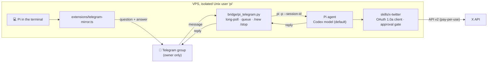

# pi-vps-telegram-agent

A self-hosted AI coding agent that I run on a VPS and use from my phone. It runs
[Pi](https://pi.dev), an open-source terminal coding agent, on a small cloud server. A Telegram group
works as its chat window, and an approval gate means it can't post on X (Twitter) without my yes.

I wanted an agent that keeps working when my laptop is closed, that I can reach from my phone, and
that I can trust with real credentials. This repo contains the glue code that makes that work.



## What it does

- **Use the agent from your phone.** Every message in one Telegram group goes to a single ongoing Pi
  conversation, and the reply comes back to the group. Telegram shows "typing…" while the agent runs
  tools. `/new` starts a fresh conversation and `/stop` cancels the current answer. Messages sent
  while it's busy are queued.
- **One place to see everything.** A Pi extension also posts terminal sessions to the same group, so
  the phone shows all the agent's work whether it was started from SSH or from Telegram. Runs started
  by the bridge are tagged so they aren't posted twice.
- **X (Twitter) as an agent skill.** A dependency-free OAuth 1.0a client for the X API v2 (search,
  mentions, home feed, post, reply, delete), packaged as a Pi skill. Posting and deleting require an
  explicit `--yes`, and the skill tells the agent to get the owner's approval of the exact text first.
- **Runs unattended.** A systemd service restarts the bridge on failure and starts it on boot.

## Security model

An agent that can run shell commands on my behalf needs boundaries that don't depend on the model
behaving well.

| Risk | Control |
|---|---|
| Strangers messaging the bot | `classify()` acts only on one Telegram **user id** in one **chat id**. Everything else is ignored and the bot never replies. |
| Agent damaging the rest of the server | Pi runs as a separate unprivileged `pi` user (no sudo, home dir `750`). It can't read other users' files. |
| Credentials leaking into git | Secrets live in `600` files in the `pi` user's home (`~/.pi_telegram`, `~/.x_keys`) and are listed in `.gitignore`. The repo ships only `.env.example`. |
| Agent posting publicly by mistake | Two layers: the skill's instructions require the owner's approval of the exact text, and the CLI refuses `post`/`delete` without `--yes`. Covered by a test. |
| Runaway API spend | X credits are prepaid (no auto top-up), reads use X's minimum page size, and the skill lists per-call prices so the agent can warn before large reads. |
| A crash replaying a prompt | The Telegram offset is saved before a message is handled, so a restart never runs the same prompt twice. |

## Design decisions

- **One `pi -p` process per message, sharing a `--session-id`**, rather than one long-lived RPC
  process. It's simpler and has no state to corrupt, and a hung run can be killed without losing
  the conversation, which is saved on disk by Pi. The cost is a little startup time per message.
- **Long polling, not webhooks.** The server needs no public HTTPS endpoint, so it has no inbound
  attack surface.
- **Standard library only** for the Python pieces (`urllib`, `hmac`, `subprocess`), so there's
  nothing to `pip install` on the server and no dependency supply chain to audit.
- **The same code runs in production.** `deploy/install.sh` installs exactly what's in this repo.

## Tests

```bash
python3 -m pytest -q   # 8 tests
```

- The OAuth signer is checked against the **worked example in Twitter's signature documentation**
  (same inputs, same `oauth_signature`).
- Bridge tests cover the owner/chat lock, commands with and without `@BotName`, ignored service
  messages, splitting replies under Telegram's 4096-character limit, session rotation and queuing.

## Setup

Assumes a Linux server with a `pi` user that already has Pi installed and signed in.

1. Create a bot with **@BotFather**, then `/setprivacy` → **Disable** so it can read group messages.
2. Create a Telegram group, add the bot, and send a message. Read the chat id and your user id from
   `https://api.telegram.org/bot<TOKEN>/getUpdates`.
3. `sudo ./deploy/install.sh`. The first run creates `/home/pi/.pi_telegram` from `.env.example`.
   Fill it in and run the script again.
4. Optional, for X: create an app at console.x.com with **Read and write** permissions and save the
   four OAuth 1.0a values to `/home/pi/.x_keys` (`X_API_KEY`, `X_API_SECRET`, `X_ACCESS_TOKEN`,
   `X_ACCESS_SECRET`, mode `600`).

## Layout

```
bridge/pi_telegram.py            Telegram <-> Pi bridge (systemd service)
extensions/telegram-mirror.ts    Pi extension: post terminal sessions to the group
skills/x-twitter/                Pi skill: SKILL.md instructions + scripts/x.py client
deploy/                          systemd unit + idempotent installer
tests/                           pytest suite
```

## Next

- Several personal-assistant agents, each with its own instructions, notes and Telegram topic.
- Passing photos and files between Telegram and the agent.
- Scheduled agent runs, such as a morning briefing posted to the group.

MIT licensed.
